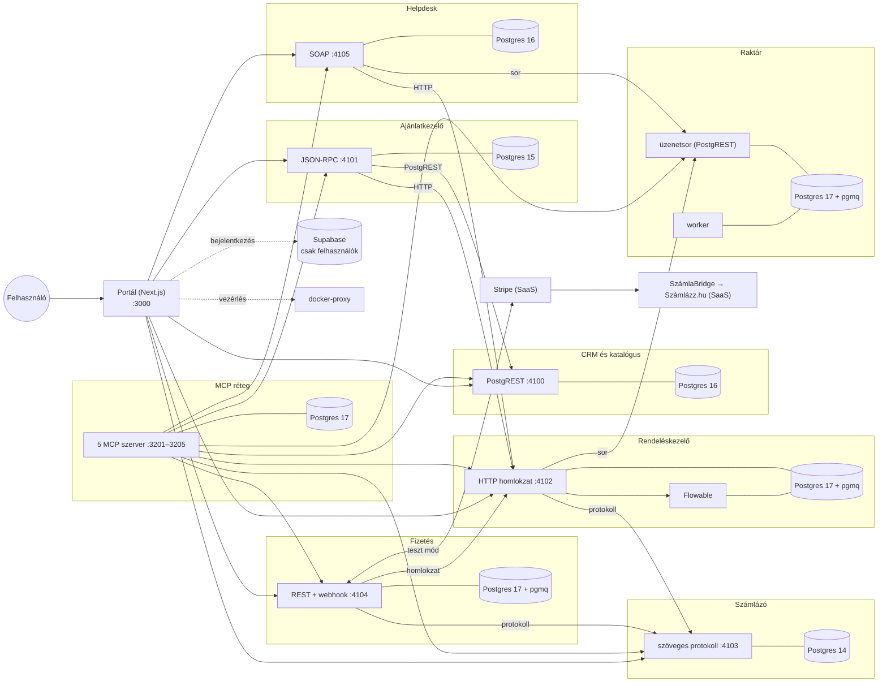

# Legacy CRM – a prototípus bemutatása

*Állapot: 2026. október 20. · elkészült: a legacy rendszer (1–11. fázis, a 12. opcionális), az MCP réteg (13–14.) és a független rendszerek konténerekben (15.)*

## 1. Mi ez, egy mondatban

Egy elképzelt, kb. 40 fős magyar B2B kereskedő (irodatechnika és ipari eszközök) **szándékosan heterogén, „legacy” vállalatirányítási rendszere**. Nyolc modulból áll, és mindegyik modul más-más korú és stílusú interfészen érhető el. Ez a rendszer lesz a szakdolgozat következő részében az a terep, amelyet egy **MCP szerveren keresztül AI ágensek** fognak vezérelni.

## 2. Miért kell, hogy „rossz” legyen?

A szakdolgozat kérdése az, hogyan lehet egy valódi, évek alatt összenőtt vállalati rendszert ágens-alapú működésre átállítani. Ehhez olyan rendszer kell, amely **úgy viselkedik, mint egy valódi legacy rendszer**:

- a modulok **más-más protokollon** kommunikálnak: PostgREST, JSON-RPC, egyedi szöveges protokoll, SOAP, REST + webhook, üzenetsor, BPMN folyamatmotor;
- **eltérő azonosítókat, dátum- és pénzformátumokat** használnak;
- **eltérő stílusban jelzik a hibát**: hibakód, szöveges üzenet, HTTP státusz, SOAP Fault;
- az adatokban **szándékos ellentmondások** vannak, például egy cég kétféleképpen írva, hiányzó raktári kódok, lejárt számlák;
- az admin felületen **nincs egységes ügyfélnézet és globális keresés**: a felhasználónak modulról modulra kell kattintania.

**A szabály:** modulon belül a kód tiszta, de a modulok között semmit nem egységesítettünk. Ez a „rendetlenség” maga a kísérleti terep, amelyhez később az ágensek teljesítményét mérjük.

## 3. Architektúra

**A 15. fázis óta minden rendszer független:** saját konténercsoport (adatbázis + belső PostgREST + szolgáltatás), saját adatbázissal, és egyenként ki- és bekapcsolható. A rendszerek csak a hivatalos interfészeiken beszélnek egymással. A Supabase-ben csak a felhasználók vannak (bejelentkezés + szerepkör).



**Technológiák:**
- **Rendszerek:** Node 24 (a meglévő route handlerek egy kis HTTP-hosztolón), esbuild-del rendszerenként egy fájlba csomagolva; Postgres 14–17 + PostgREST; pgmq a sorokat használó rendszereknél.
- **Folyamatmotor:** Flowable 7.2.0, a rendeléskezelő része, saját adatbázissal.
- **Portál:** Next.js 16 (App Router, TypeScript), shadcn/ui, Tailwind v4; bejelentkezés: Supabase Auth.
- **Külső SaaS:** Stripe (teszt mód), SzámlaBridge → Számlázz.hu (tesztfiók).
- **Konténerek:** Docker Compose, kb. 29 konténer, kb. 1,7 GB memória.
- **Könyvtárak:** `pdf-lib` (számla-PDF), `fast-xml-parser` (SOAP), `zod` (validáció), `@modelcontextprotocol/sdk` (MCP).

## 4. A nyolc modul

| Modul | Interfész | Hozzáférés | Azonosító | Dátum | Pénz | Hibák |
|---|---|---|---|---|---|---|
| **CRM** | PostgREST | Supabase JWT | UUID | ISO 8601 | `numeric(14,2)` | PostgREST hibák |
| **Katalógus** | PostgREST + `price_for` RPC | Supabase JWT | `TK-00042` | ISO | `numeric(12,2)` | HTTP 404/400 |
| **Ajánlatmotor** | JSON-RPC 2.0 | kulcs a `params.apiKey`-ben | `AJ-2026-0042` | `YYYY-MM-DD` | egész forint | `-32010 DISCOUNT_APPROVAL_REQUIRED` stb. |
| **Rendelések** | régi HTTP homlokzat + Flowable BPMN | `X-Legacy-Key` | `100045` / `RND-100045` | ISO | `numeric` | mindig HTTP 200, `{"success":false,"msg":"Keszlet foglalas sikertelen: 4711 (hiany: 3 db)"}` |
| **Raktár** | csak üzenetsor (pgmq) | – | `4711` (integer) | Unix epoch | – | `R-01` … `R-04`, `R-99` |
| **Számlázás** | egyedi szöveges protokoll | `AUTH\|<kulcs>` az első sorban | `SZ-2026-000187`, `VEVO-1023` | `YYYY.MM.DD` | `38100,00` | `ERR\|E107\|VEVO NEM TALALHATO` |
| **Fizetés** | REST + Stripe webhook | `Bearer` token | UUID + Stripe ID | ISO | fillér (Stripe minor unit) | HTTP státusz + `{"error":{type,message}}` |
| **Ügyfélszolgálat** | SOAP 1.1 + WSDL | SOAP Header `<hd:ApiKey>` | `HJ-000321`, `RMA-2026-0012` | `xsd:dateTime` | – | SOAP Fault: `HD-404` |

Minden modulnak **saját adatbázis-sémája** van, saját azonosító-generátorral. A modulok között **nincs idegen kulcs**, és egymást csak a másik modul interfészén keresztül érik el.

## 5. Az order-to-cash folyamat végigvezetve

Egy rendelés útja ajánlattól a pénz beérkezéséig, hat különböző protokollon át:

1. **Ajánlat (JSON-RPC):** `quote.create`, majd `quote.addLine`, majd `quote.calculate`.
   - **Árazás** TypeScriptben, egész számokkal: listaár → ügyfélcsoport-kedvezmény (a katalógusból) → tételkedvezmény → mennyiségi kedvezmény (10 db felett +3%, 50 felett +5%).
   - **Jóváhagyás:** 15% feletti összkedvezménynél az elfogadás `-32010` hibát ad, amíg egy vezető jóvá nem hagyja (`requestApproval` → `approve`).
2. **Elfogadás → rendelés:** a `quote.accept` a rendelésmodul HTTP homlokzatán létrehozza a rendelést. A homlokzat elindít egy Flowable folyamatpéldányt, amelynek business key-e a rendelésszám.
3. **Jóváhagyás (user task):** a BPMN HTTP taskja visszahívja a Next.js motor-végpontját. Ez a raktári üzenetsoron `FOGLAL` parancsot küld minden tételre, és megvárja a választ. Ha nincs elég készlet, a folyamat visszatér a jóváhagyáshoz, a homlokzat pedig ezt válaszolja: *„Keszlet foglalas sikertelen: 4717 (hiany: 1 db)”*.
4. **Kiszállítás indítása (user task):** szállítmány jön létre, és a lefoglalt készlet kiadásra kerül (`MOZGAS KI`). Ezután a BPMN **percenként lekérdezi a fuvarozói állapotot**. A fuvarozót egy pg_cron szimulálja: ~15% eséllyel `KESIK` állapotba tesz egy szállítmányt; ilyenkor a folyamat egyszer `SHIPMENT_DELAYED` eseményt küld.
5. **Számla kiállítása (user task):** a motor a számlázó szöveges protokollján:
   - megkeresi a vevőt adószám alapján, és ha nincs, felveszi (`PARTNER|UJ`);
   - **díjbekérőt** állít ki (`DIJBEKERO|KESZIT`), és ahhoz PDF készül.
6. **Fizetés (REST + Stripe):** fizetési link (Stripe Checkout, forintban), az összeget a számlázó protokollból (`SZAMLA|LEKER`) kérdezi le.
   - A Stripe **webhookja**: a fizetés `SUCCEEDED` lesz → a díjbekérő `SZAMLA|FIZETVE` → `payment_events` esemény → `FizetesBeerkezett` üzenet a Flowable-nek → a rendelés **`LEZART`**.
   - **A végleges számla:** a sikeres fizetés után a **SzámlaBridge** kiállítja a **Számlázz.hu tesztszámlát** (tesztüzemben nincs NAV-adatszolgáltatás). A számlázó a fizetés azonosítója alapján visszaköti, és a `SZAMLA|PDF` már a Számlázz.hu PDF-jét adja.
7. **Lemondás bármikor:** a BPMN eseményalapú alfolyamata feloldja a foglalást, és ha volt számla, **sztornózza**.
8. **Utóélet (SOAP):** hibajegy, garanciaellenőrzés a rendelés `SZALLITVA` időpontja és a katalógus garanciaideje alapján (`W-OK` / `W-EXP` / `W-NOTDELIVERED` / `W-NOORDER`), RMA (csere esetén foglalás a raktárban, javítás esetén visszáru).

Minden állapotváltásról esemény kerül az `order_events` sorra, minden fizetésről a `payment_events` sorra. Ezeket a későbbi MCP szerver is olvasni tudja.

## 6. A rendelési folyamat (BPMN)

```
ROGZITETT ──[jóváhagyás + készletfoglalás]──► JOVAHAGYOTT ──[kiszállítás]──► TELJESITES_ALATT
   ▲   └─ hiány esetén vissza a jóváhagyásra                                    │
   │                                                    (percenkénti szállításkövetés, késés-esemény)
   │                                                                             ▼
LEZART ◄──[FizetesBeerkezett üzenet]── SZAMLAZVA ◄──[számla kiállítása]── SZALLITVA

bármikor ──[RendelesLemondas üzenet]──► foglalás feloldása → (sztornó, ha volt számla) → LEMONDOTT
```

- **Megvalósítás:** szabványos BPMN 2.0 XML (`flowable/processes/rendeles_folyamat.bpmn20.xml`), Flowable-kiterjesztésekkel, 3 user taskkal, időzítővel és üzenetekkel.
- **Integráció Java kód nélkül:** minden kapcsolat a Flowable beépített HTTP taskjával történik.
- **Megjelenítés:** diagram-információt is tartalmaz, így a **bpmn.io**-ban megnyitható.
- **Csak a BPMN dönt:** saját állapotgép nincs, a homlokzat csak a megfelelő user taskot zárja le.

## 7. Szándékos anomáliák a tesztadatokban (seed)

- **Mennyiségek:** 30 partner, 60 kapcsolattartó, 25 értékesítési lehetőség, 40 termék, 37 raktári cikk, 8 ajánlat, 12 rendelés (minden állapotból), 10 számla, 5 hibajegy.
- **Katalógus és raktár:**
  - 3 terméknek nincs raktári kódja, ezért nem foglalható;
  - 2 terméknél a raktári megnevezés eltér a katalógusbelitől;
  - 4 cikk a minimumkészlet alatt van, 2 cikk 0 készlettel.
- **Számlázás:**
  - 2 CRM-partner hiányzik a számlázó vevői közül;
  - 1 vevő neve eltérően szerepel: „Duna Irodaház Kft” vs. „DUNA-IRODAHAZ KFT.”;
  - 3 lejárt, kifizetetlen számla.
- **Tesztesetek a későbbi funkciókhoz:**
  - egy inaktív termék;
  - mind a négy garancia-indokkódhoz egy-egy hibajegy;
  - egy rendelés, amelynek a partnere még nincs a számlázóban, és a jóváhagyásához sincs elég készlet.

## 8. Mi készült el, fázisonként

| # | Fázis | Lényeg | Füstteszt |
|---|---|---|---|
| 1 | **Alapok** | 8 modulséma, `flowable` séma, 5 üzenetsor, cron jobok, seed a fenti anomáliákkal | 37/37 ✔ |
| 2 | **CRM + katalógus** | jogosultságok (RLS), PostgREST-kiajánlás, `price_for` árfüggvény (404/400 hibákkal) | 13/13 ✔ |
| 3 | **Raktár** | PL/pgSQL worker 5 mp-enként; 5 parancs; dead letter: 3 sikertelen próbálkozás után archívum; minimumkészlet-figyelmeztetés; poll segéd | 13/13 ✔ |
| 4 | **Ajánlatmotor** | JSON-RPC 2.0, 8 metódus, árazás egész aritmetikával, kedvezmény-jóváhagyás, lusta lejárat | 20/20 ✔ |
| 5 | **Számlázás** | szöveges protokoll 9 paranccsal, **PDF bizonylat** (Számlázz.hu helyett), sztornó, szimulált NAV-napló | 30/30 ✔ |
| 6 | **Flowable alapok** | Docker-konténer a Supabase-en (62 tábla a saját sémában), REST kliens, BPMN-telepítés | 12/12 ✔ |
| 7 | **Rendelések** | BPMN folyamat, motor-végpontok, régi stílusú homlokzat, szállításkövetés, lemondás + sztornó | 33/33 ✔ |
| 8 | **Fizetés** | REST + Stripe Checkout (HUF), aláírt webhook, idempotens feldolgozás, rendelés lezárása | 22/22 ✔ |
| 9 | **Ügyfélszolgálat** | SOAP 1.1, kézzel írt WSDL, 7 művelet, garanciaellenőrzés, RMA | 24/24 ✔ |
| 10 | **Admin felület** | 8 modul-oldal oldalmenüvel, számlázó terminál, raktári sorpanel, aktív user task és folyamattörténet | `next build` ✔ |
| 11 | **Legacy dokumentáció + order-to-cash** | 7 interfészleírás modulonként eltérő stílusban (+ WSDL) a `legacy-docs/` mappában; teljes füstteszt ajánlattól lezárásig, hat protokollon át | 18/18 ✔ |
| 13 | **MCP alapok + `orders` szerver** | kanonikus modell, egységes hiba, szerepkörök, idempotencia, napló, stdio + HTTP, modellfüggetlenségi lint; 9 eszköz, feliratkozás | 45/45 ✔ |
| 14 | **A többi négy MCP szerver** | `sales`, `inventory`, `finance`, `support` (24 eszköz), kockázati osztály, közös törzsadat-fordítás; **order-to-cash kizárólag MCP-n** | 32 + 17 + 21 + 27 + 20 ✔ |
| 15 | **Független rendszerek** | rendszerenként saját konténer és adatbázis (Postgres 14–17), a Supabase csak a felhasználóké, ki/be kapcsolás a portálból, kiesés-szimuláció | 22/22 ✔ (+ 01–14 a konténereken) |

**Összesen kb. 400 automatikus ellenőrzés** (a legacy rendszeré, az MCP rétegé és a 15. fázisé), mind sikeres, a konténeres rendszeren. A tesztek a valódi felhőadatbázison, a valódi Flowable-motoron és a Stripe teszt módján futnak, mock nélkül.

**Számokban:**
- 17 adatbázis-migráció;
- 10 füstteszt-szkript, köztük egy teljes order-to-cash teszt (~100 mp);
- 7 modulonkénti interfészleírás;
- 9 legacy végpont;
- 18 admin oldal;
- kb. 12 500 sor saját kód (TypeScript, SQL, BPMN, WSDL).

## 9. Fontos döntések és eltérések a specifikációtól

| Döntés | Miért |
|---|---|
| **Számlázz.hu tesztszámla a SzámlaBridge-en keresztül, díjbekérő → fizetés → számla sorrendben** | A bridge a sikeres Stripe-fizetés után állít ki számlát, ezért a fizetés előtt díjbekérő készül (különben dupla számla lenne). A Számlázz.hu tesztfiókban nincs NAV-adatszolgáltatás; az app csak teszt üzemben fut. A saját PDF a díjbekérőkre maradt. |
| **Minden modulséma ki van ajánlva a PostgREST-en, de jogot csak a szerver kap** | A Next.js szerver csak így éri el a sémákat. Kívülről (anon vagy bejelentkezett felhasználóként) csak a CRM és a katalógus látszik. |
| **Új SOAP-művelet: `ReceiveRMA`** | A spec szerint javításnál „beérkezéskor” kell visszárut rögzíteni, de erre nem volt művelet. |
| **A Flowable táblái háromszoros védelemmel kerülnek a saját sémába, és legfeljebb 5 adatbázis-kapcsolatot használ** | A Supabase pooler nem garantáltan adja tovább a sémabeállítást. Az alapértelmezett 50 kapcsolat pedig kimerítené az adatbázis keretét. |
| **Atomi műveletek PL/pgSQL függvényekben** (számla kiállítása, sztornó, rendelés rögzítése) | Egy félbeszakadt kérés ne hagyhasson tétel nélküli számlát vagy kihagyott sorszámot. |
| **Idempotens webhook és protokoll-parancsok** | A Stripe újraküldheti az eseményt; egy dupla fizetési jelzés se okozzon hibát. |
| **A sorok tartalmát nem lehet olvasással megnézni** | Az olvasás növeli a számlálót, és egy egyszerű betekintés dead letterbe juttathatna egy parancsot. Ezért a sorpanel csak betekint. |
| **A szinkron raktári hívás szándékosan lassú (~10 mp)** | A spec kéri: „legacy-szerűen lassú és ügyetlen – maradjon is az”. |

Minden döntés indoklással együtt a `README.md` változtatási naplójában is szerepel.

## 10. Bemutató-forgatókönyv (kb. 15 perc)

**Előkészítés:**
- **Szolgáltatások indítása:**
  ```bash
  npm run stack:up                                   # minden rendszer + portál (Docker Desktop fusson)
  npm run dc -- --profile stripe up -d stripe-cli    # Stripe webhook-továbbító (a fizetéshez)
  ```
- **Bejelentkezés:** `http://localhost:3000/auth/login` (admin szerepkörű felhasználóval – a Rendszerek oldalhoz kell).
- **Előre készíts el egy rendelést `SZALLITVA` állapotig.** A szállításszimuláció és a percenkénti követés miatt ez élőben 3–4 percig tartana.
- **Nézd át egyszer az admin oldalakat.** A felületet automatikusan nem ellenőriztük böngészőben, csak a build és a végpontok vannak tesztelve.

**Menet:**
1. **Nyitóoldal (`/`):** a koncepció és a heterogenitás bemutatása, majd az **Admin felület**.
2. **CRM:** a Bakony Gépgyártó partner (KIEMELT csoport), kapcsolattartók, értékesítési lehetőségek. Mutasd meg, hogy az ügyfélnek nincs egységes nézete.
3. **Katalógus:** a TK-00001 árai a négy ügyfélcsoportnak (`price_for`).
4. **Ajánlatok:** új ajánlat a Bakonynak (UUID a CRM oldalról).
   - Tétel: `TK-00032` × 12, 5% tételkedvezmény, majd **Számolás**: 15,22%, jóváhagyás szükséges.
   - **Elfogadás** → `-32010 DISCOUNT_APPROVAL_REQUIRED`.
   - **Jóváhagyás kérése** → **Jóváhagyás** → **Elfogadás** → rendelésszám.
5. **Rendelések:** az új rendelés, aktív user task: *Rendelés jóváhagyása*.
   - **Jóváhagyás** (kb. 10 mp, mert a raktári sor lassú).
   - A folyamattörténetben látszik az átmenet.
6. **Raktár:** a lefoglalt készlet; a **sorpanelen** az üzenetforgalom, az archívumban a dead letter.
7. **Az előkészített rendelés:** **Számla kiállítása** → **Számlázás** oldal → **PDF** megnyitása.
8. **Számlázó terminál:** `SZAMLA|LEJART`, `PARTNER|KERES|27346178-2-41` (az eltérő névírás), egy hibás parancs → `ERR|E100`.
9. **Fizetés:** fizetési link a számlához → Stripe Checkout, tesztkártya `4242 4242 4242 4242`.
   - A webhook után: fizetés `SUCCEEDED`, számla fizetve, rendelés **`LEZART`**.
10. **Ügyfélszolgálat:** `HJ-000317` → **Garancia** → `W-OK`; `HJ-000318` → `W-EXP`; egy RMA indítása.
11. **Rendszerek (kiesés élőben):** a *Rendszerek* oldalon látszik a 8 független rendszer (állapot, egészség, memória, konténerek).
    - **Számlázó → Leállítás.** A fizetés és a rendeléskezelő „érintett” jelzést kap. A *Fizetés* oldalon egy új fizetési link `502 billing_unavailable` hibát ad. Ha az MCP Inspector nyitva van, a `get_document` `UPSTREAM_UNAVAILABLE` (retryable) hibát.
    - **Indítás** után minden újra működik, az adatok megmaradtak (saját adatbázis, saját kötet).
12. **Kitekintés:** a BPMN megnyitása a demo.bpmn.io oldalon; a `legacy-docs/` leírásai (egymás mellett mutatva a stílusbeli különbségeket); a **teljes order-to-cash füstteszt** élő futtatása: `npx tsx scripts/smoke/11-order-to-cash.ts` (~100 mp, lépésenként kiírja, melyik modul melyik protokollon dolgozik).

**Erős pontok, amiket érdemes kiemelni:**
- egyetlen rendelés hat különböző protokollon halad át;
- a hibák modulonként teljesen más formában jönnek;
- minden modul önállóan, valódi infrastruktúrán tesztelt (204 ellenőrzés).

## 11. MCP réteg (13–14. fázis)

A legacy rendszer fölé öt **domain MCP szerver** került. Ezek elrejtik a nyers interfészeket (homlokzat, JSON-RPC, pgmq, szöveges protokoll, REST, SOAP) és a közvetlen DB-hozzáférést. Az ágens csak egységes, „kanonikus” eszközöket lát.

| Szerver | Port | Eszközök | Legacy háttér |
|---|---|---|---|
| `sales` | 3202 | vevő- és termékkeresés a vevő árával, ajánlat egy lépésben, jóváhagyás, elfogadás → rendelés | PostgREST + JSON-RPC |
| `orders` | 3201 | rendelés, lista, történet, várakozás, jóváhagyás, kiszállítás, díjbekérő, módosítás, lemondás + feliratkozás | homlokzat + Flowable |
| `inventory` | 3203 | készlet termékkódon, minimum alatti tételek, korrekció | pgmq üzenetsor |
| `finance` | 3204 | bizonylat, lejárt tartozások, PDF, fizetési link (Stripe teszt), fizetések | szöveges protokoll + REST |
| `support` | 3205 | hibajegy, garancia, csere és javítás | SOAP |

**Mit mutat meg:**
- **Egy adat-szerződés mindenhol** ([mcp-kanonikus-modell.md](mcp-kanonikus-modell.md)):
  - a pénz `{amount:"38100.00", currency:"HUF"}`, a dátum ISO;
  - az azonosító `customerId` / `sku` / `orderId`; a raktári cikkszám és a `VEVO-` kód soha nem jut ki;
  - angol állapotkód magyar felirattal;
  - `nextAction`: ki, mit, melyik eszközzel.
- **Egységes hiba:** a `-32010`, a `Keszlet foglalas sikertelen: 4717 (hiany: 1 db)`, az `ERR|E108` és a `HD-409` helyett mindig `{code, message (magyar), retryable, suggestedActions, details}` jön. Például `INSUFFICIENT_STOCK {sku:"TK-00018", missing:1}`, termékkóddal.
- **Biztonság:**
  - hat szerepkör, Bearer token;
  - kockázati osztály minden eszközön (`read`, `write`, `financial`, `irreversible`);
  - idempotens írások;
  - minden hívás naplózva (`mcp.tool_calls`);
  - a vevőtől jövő szöveg megbízhatatlanként jelölve (prompt injection).
- **Modellfüggetlenség** (a cél egy helyben futó LLM): pont nélküli eszköznevek, lapos sémák, angol leírás, magyar felhasználói szöveg. Egy automatikus „lint” ellenőrzi.
- **Legacy-csapdák, amelyeket a réteg semlegesít:**
  - az ajánlatmotor „`totalGross`” mezője valójában listaár-összeg, nem ÁFÁ-s bruttó;
  - a SOAP `HD-409` kétértelmű;
  - a BPMN-ben az állapot előbb változik, mint ahogy a következő feladat létrejön.

**Bemutatható élőben:**
- `npm run mcp:all`, majd az MCP Inspectorban (`npx @modelcontextprotocol/inspector`) egy eszköz hívása és egy hibaeset;
- vagy a **teljes order-to-cash csak MCP-n**: `npx tsx scripts/smoke/14-mcp-order-to-cash.ts` (~2 perc). Öt szerveren, szerepkörhöz illő tokenekkel halad ajánlattól a Számlázz.hu tesztszámláig és a garanciáig. A végén kiírja, hány hívás történt szerverenként, mennyi ideig tartottak, és mekkora volt a válaszok mérete (a tokenomics mérés alapja).

## 12. Az ágens (17. fázis)

**Mit mutat:** egy chat-szerű segéd, amely magyarul kapja a kérést, és csak az MCP rétegen dolgozik. A modell helyben fut (Ollama, `gemma4:e4b`), az adat nem megy ki a felhőbe. Írás előtt megáll és megkérdez.

**Bemutatható élőben (portál):** a menüben **Asszisztens** → „A Bakony Gépgyártó 2 darab TK-00010-es monitort rendel. Készíts ajánlatot, és vedd fel a rendelést.” → két jóváhagyási kártya (Ajánlat készítése, Ajánlat elfogadása) → a végén az ajánlat és a rendelés száma; a válasz alatt a lépések idővonala. Elutasításnál az asszisztens közli, hogy nem történt meg. Megtekintő szerepkörrel jóváhagyás után is elutasítja az MCP.

**Ugyanez parancssorból:**
1. `npm run agens -- --szerep viewer --reszletek "Hol tart az RND-… rendelés?"` – a front-desk a rendelés-státusz ágenshez irányít, az a `get_order`-rel válaszol; a `--reszletek` kiírja a lépéseket, a tokeneket és az időket.
2. `npm run agens -- --szerep sales "A Bakony Gépgyártó 2 darab TK-00010-es monitort rendel. Készíts ajánlatot, és vedd fel a rendelést."` – két jóváhagyási kérdés (`create_quote`, `accept_quote`), mindkettőre „i”, a végén az ajánlat és a rendelés száma (~10 s). A portál Rendelések oldalán a rendelés megjelenik.
3. Ugyanez „n”-nel: az ágens közli, hogy nem történt meg, és az MCP naplójában sincs író hívás.
4. Ugyanez `--szerep viewer`-rel: jóváhagyás után is elutasítja az MCP (`FORBIDDEN`) – az ágens nem tud többet, mint a felhasználó.
5. Megállás és folytatás: egy jóváhagyásnál Ctrl+C, majd `npm run agens -- --folytat <beszélgetés-azonosító>` – ugyanonnan folytatódik (ez lesz a 18. fázis webes jóváhagyása).

**Mérés:** `npx tsx scripts/agens-meres.ts` (két modell összevetése), `npx tsx scripts/smoke/17-agens-elo.ts` (sikerességi arány).

## 13. Ami még hátravan

- **18. fázis:** asszisztens felület a portálon (`/asszisztens`, jóváhagyási kártyák) és eseményvezérelt kivételkezelő.
- **19. fázis:** értékelés – a régi munkamód, a portál és az ágens (MCP-vel és nyers legacy interfészekkel) összevetése: pontosság, tokenek, válaszidő, lépésszám.
- **12. fázis (opcionális):** TCP-csatoló a számlázó protokollhoz (9100-as port).
- **Később:** UCP-integráció.
